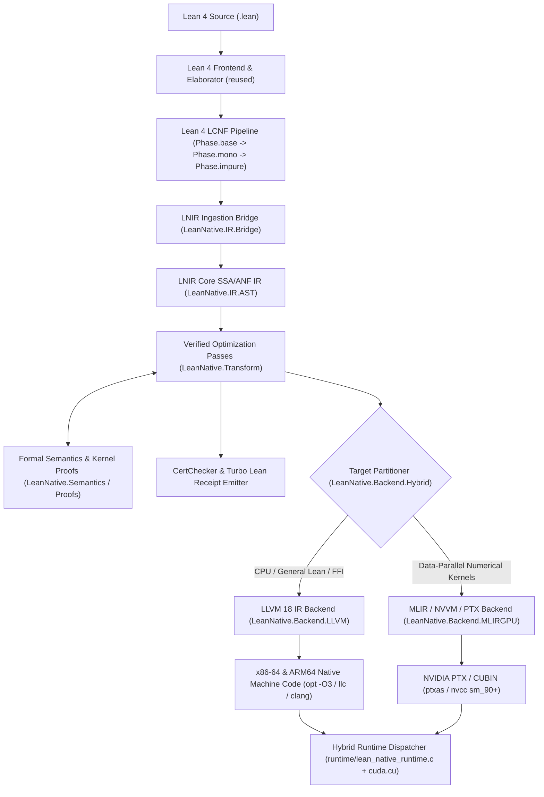

# Lean Native (`lean-native`) Architecture

## 1. System Overview

`lean-native` is a formally validated, self-optimizing native compiler for Lean 4 targeting **x86-64**, **ARM64**, and **NVIDIA CUDA (NVVM/PTX)** with automatic hybrid CPU/GPU execution.

---

## 2. Intermediate Representation (`LNIR`)

`LNIR` (`LeanNative.IR.Types` and `LeanNative.IR.AST`) bridges Lean 4's `LCNF` and low-level target code generation:

- **Types (`LNIRType`)**:
  - Unboxed scalars: `i1`, `i8`, `i16`, `i32`, `i64`, `usize`, `f32`, `f64`
  - Unboxed product/struct types: `tuple (fields : List LNIRType)` (enabling multi-value register return and SROA across join points and worker calls)
  - Contiguous unboxed buffers/slices: `sarray (elem : LNIRType)` (modeling `ByteArray`, `FloatArray`, and monomorphized `UInt64`/`Float` buffers with explicit exclusivity state)
  - Managed heap pointers: `objPtr` (`lean_object*`), `taggedPtr` (`tobject` / tagged scalar)
- **Operations & Structured Control Flow (`LNIRExpr`, `LNIRStmt`, `LNIRCode`)**:
  - Pure scalar & bitvector ALU operations (`add`, `sub`, `mul`, `div`, `mod`, `shl`, `shr`, `bitAnd`, `bitOr`, `bitXor`, `cmp`, `select`, `fma`)
  - Tuple construction & projection (`mkTuple`, `projTuple`)
  - Explicit RC & constructor operations (`allocCtor`, `ctorGetObj`, `ctorGetScalar`, `ctorSetObj`, `ctorSetScalar`, `incRef`, `decRef`, `isExclusive`)
  - Contiguous scalar array operations (`sarrayLen`, `sarrayDataPtr`, `sarrayEnsureExclusive`, `rawLoad`, `rawStore`)
  - Structured loops & data-parallel kernels:
    - `seqFor (lo hi : VarId) (init : VarId) (body : LNIRCode)`: Sequential counted loop with unboxed induction variable and register-resident accumulator.
    - `parFor (n : VarId) (inputs : List VarId) (output : VarId) (kernel : ParallelKernel)`: Data-parallel map/zipWith/stencil/reduction kernel eligible for GPU PTX lowering or CPU SIMD vectorization (`!llvm.loop.vectorize.enable`).

---

## 3. Formally Verified Optimization Passes

Every optimization pass in `LeanNative.Transform` implements the `VerifiedPass` interface:
1. **`AlgebraicOpt`**: Strength reduction (`x * 2^k -> x << k`, `x / 2^k -> x >> k`), additive/multiplicative identities (`x + 0 -> x`, `x * 1 -> x`, `x * 0 -> 0`), idempotent bitwise folding (`x & x -> x`, `x ^ x -> 0`), and constant propagation.
   - **Formal Guarantee**: Kernel-checked proof in `LeanNative.Proofs.PeepholeProofs` (`evalExpr_optimizeExpr_eq`).
2. **`UnboxTupleSROA`**: Eliminates intermediate heap constructor allocations (`allocCtor` / `mkTuple` followed by `projTuple`) across let-bindings and tail-recursive join points.
   - **Formal Guarantee**: Kernel-checked proof in `LeanNative.Proofs.LoopOptProofs` (`eval_unboxTupleSROA_refines`).
3. **`HoistExclusivity`**: Hoists `sarrayEnsureExclusive` (`lean_sarray_ensure_exclusive`) and `sarrayDataPtr` (`m_data`) out of `seqFor` / `parFor` loops when the target scalar array does not escape the loop body, converting per-iteration `uset` calls into direct `noalias` pointer stores.
   - **Formal Guarantee**: Kernel-checked proof in `LeanNative.Proofs.LoopOptProofs` (`eval_hoistExclusivity_refines`).
4. **`LoopVectorizeOpt`**: Recognizes unboxed scalar loops (`seqFor` / `parFor`), hoists small-`Nat` scalar guards to loop preheaders, and attaches LLVM loop vectorization (`!llvm.loop.vectorize.enable`) and noalias metadata.

---

## 4. Target Backends & Hybrid Runtime

### 4.1 LLVM 18 CPU Backend (`LeanNative.Backend.LLVM`)
- Emits modern LLVM 18 opaque-pointer IR (`ptr`) with target triples `x86_64-unknown-linux-gnu` and `aarch64-unknown-linux-gnu`.
- Inlines hot-path RC operations (`m_rc > 0` single-threaded increment/decrement with `@llvm.expect.i1`), scalar tagging (`lean_box` / `lean_unbox`), and contiguous scalar array pointer indexing (`getelementptr inbounds double/i64, ptr %data, i64 %idx`).
- Preserves full compatibility with `libleanshared.so` and C/Rust FFI (`@[extern]`).

### 4.2 MLIR / NVVM / PTX GPU Backend (`LeanNative.Backend.MLIRGPU`)
- Analyzes `parFor` and numerical kernel declarations for GPU eligibility (pure scalar arithmetic over contiguous `sarray` buffers, free of heap allocations or recursive closures).
- Emits both:
  1. **MLIR (`gpu` + `scf` + `arith` + `memref` + `nvvm` dialect module)** for MLIR toolchain pipelines, and
  2. **Direct NVVM / PTX 8.0 assembly (`.ptx`)** with 1D/2D grid-stride thread indexing (`%tid.x`, `%ntid.x`, `%ctaid.x`, `%nctaid.x`), fused multiply-add (`fma.rn.f64` / `mad.lo.u64`), and bounds guards (`setp.ge.u64 %p, %idx, %n; @%p bra DONE;`), compiled and validated by `ptxas` / `nvcc`.

### 4.3 Hybrid CPU/GPU Execution (`LeanNative.Backend.Hybrid` & `runtime/`)
- Automatically partitions programs into GPU kernels (compiled to PTX/CUBIN) and host orchestration + non-GPU functions (compiled by the LLVM CPU backend).
- Uses an adaptive cost model (`N >= LEAN_NATIVE_GPU_MIN_ELEMS`, default `65536`) to dispatch large data-parallel workloads to the NVIDIA GPU via CUDA Driver API (`cuModuleLoadData`, `cuLaunchKernel`) or unified memory (`cudaMallocManaged` on Grace-Blackwell GB10), while seamlessly falling back to the SIMD-vectorized LLVM CPU kernel for small inputs or when no GPU is available.

---

## 5. v0.3 Architecture Additions: `lean-native-core`, 256-Bit EVM & Storage Maps, FastCheck Constraint Propagation, and JSON-RPC Worker

### 5.1 Split Architecture (`lean-native-core` vs `lean-native`)
- **`lean-native-core` (`LeanNative/Core.lean`, `LeanNative/Driver/CoreMain.lean`)**:
  - Zero `import Lean` dependencies; linked strictly against `libleanrt.a` + system C/C++ libraries (`3.7 MB` stripped binary, **`2.454 ms`** cold start on ARM64).
  - Ingests serialized LNIR (`LNIR_WIRE_V1` wire format or JSON via `LeanNative/IR/Codec.lean`), executes the verified optimization passes, runs `verify-certs` and `validate-tv`, and emits LLVM 18 IR, MLIR, PTX 8.0, and FastCheck kernels.
  - Provides a persistent **JSON-RPC `worker` mode** (`lean-native-core worker`) over `stdin`/`stdout` with **`0.0716 ms/req` (`13,973 req/s`)** latency on ARM64 and **`0.2154 ms/req` (`4,643 req/s`)** on x86-64.
- **`lean-native` (`LeanNative.lean`, `LeanNative/Driver/Main.lean`)**:
  - Full frontend driver linking `LeanNative.Core` with `LeanNative.IR.Bridge` and `LeanNative.Proofs.AxiomAudit` for `.lean` source elaboration, LCNF `.impure` extraction (with intra-module helper calls and strict failure when `--input <file.lean>` yields 0 declarations), and `build-exe`.

### 5.2 Native 256-Bit EVM Integers (`u256`/`i256`) & Storage Maps (`storageMap`)
- **Types & Values**: `UInt256` (`EVMWord`), `LNIRType.u256`, `LNIRType.i256`, and `LNIRType.storageMap` with formal `StorageMapState` (`slot -> UInt256` with default `0`) in `HeapState`.
- **Operations & Proofs**: 256-bit wrapping & checked-overflow operations (`addChecked256`, `subChecked256`, `mulChecked256`), full-precision 512-bit intermediate `mulDivDown` / `mulDivUp`, `clz256`, `sar`, and `storageLoad` / `storageStore`, backed by **61 machine-checked kernel theorems** (`0 sorryAx`).
- **LLVM 18 & PTX 8.0 Codegen**:
  - LLVM 18: Native `i256`, `@llvm.uadd/usub/umul.with.overflow.i256`, `@llvm.ctlz.i256`, `zext i256 to i512` for `mulDivDown`/`mulDivUp`, and `@lean_native_evm_sload` / `@lean_native_evm_sstore`.
  - PTX 8.0: 4-limb 64-bit hardware carry-chain arithmetic (`add.cc.u64` / `addc.cc.u64` / `sub.cc.u64` / `subc.u64` / `mad.lo.cc.u64` / `mad.hi.cc.u64`) in `lean_native_kernel_evm_u256_batch`.

### 5.3 Certified FastCheck Fuzzing Kernel Generator (`LeanNative/Backend/FastCheck.lean`)
- **Equality Constraint Propagation (`propagatePreconditionEqualities`)**: Rewrites guard preconditions `x_i == expr` into direct generator assignments `x_i := expr`, eliminating vacuous passes on sparse equality-constrained theorems (`0 -> 4,193` satisfied preconditions on `evm_constrained_buggy_prop`).
- **Certified Counterexample Validator (`certifyCounterexample`)**: Re-evaluates every candidate counterexample through `LeanNative.Semantics.Eval.evalCode`, backed by `certifyCounterexample_no_false_positive` (`0` false positives).
- **Native RFC-Compliant BLAKE3 (`LeanNative/TurboLean/Adapter.lean`)**: Pure-Lean BLAKE3 implementation (`blake3Hex`, `blake3SelfTest = true`) with zero `python3` subprocess calls.

---

## 6. v0.4 Architecture Additions: Zero-Redundancy `CoreCLI`, Unified GPUIR & Apple Metal 3.0, Cost-Guided Superoptimizer, and 67 Kernel Proofs

### 6.1 Shared CLI & Worker Engine (`LeanNative/Driver/CoreCLI.lean`) and Codebase Deduplication
- **Parameterized Driver (`FrontendHooks`)**: `LeanNative.Driver.CoreCLI` encapsulates all CLI argument parsing, subcommand execution (`compile-llvm`, `compile-mlir`, `compile-ptx`, `compile-metal`, `compile-fastcheck`, `compile-hybrid`, `superopt`, `verify-certs`, `validate-tv`, `self-test`, `emit-lnir`, `worker`), and the persistent JSON-RPC worker loop. `CoreMain.lean` (`24` lines) invokes `runCoreCLI args none`, while `Main.lean` (`88` lines) passes `some fullFrontendHooks`.
- **Single-Source Canonical Declarations & Embedded PTX**: `LeanNative/IR/Bridge.lean` re-exports `LeanNative.IR.Codec.mkCanonicalBenchmarkModule`, `runtime/lean_native_cuda.cu` includes `runtime/generated_kernels.ptx.h` generated directly from `LeanNative.Backend.MLIRGPU`, and `scripts/turbo_lean_bridge.py` (`216` lines) delegates directly to `lean-native-core`.

### 6.2 Unified Pass Proofs & 67 Machine-Checked Theorems (`PeepholeProofs.lean`, `FastCheck.lean`)
- **Unified Peephole & Constant-Folding Pass**: `LeanNative.Transform.AlgebraicOpt` directly calls `LeanNative.Proofs.rewriteScalarVerified` (`rewriteScalarPeephole` + `rewriteConstFoldBinOp`), backed by `evalBinOp_const_fold_sound` and `rewriteScalarVerified_sound`.
- **FastCheck Constraint-Propagation Soundness**: `substScalarExpr_nil`, `substSingleConstraint_sound`, and `propagatePrecondition_letBind_sound` formally prove that substituting an equality precondition `x == rhs` preserves evaluation semantics on all satisfying states.

### 6.3 Cost-Guided Enumerative Superoptimizer (`LeanNative/Transform/Superopt.lean`)
- Synthesizes candidate expressions using hardware latency tables (`SuperoptTarget.x86_64`, `.arm64`, `.cuda_ptx`, `.apple_metal`) and verifies every candidate through both 16-state concrete execution (`fastCheckScalarEquiv`) and symbolic translation validation (`symCheckScalarEquiv`), reducing canonical scalar latency from `54 -> 24` cycles on `x86_64` and `66 -> 22` cycles on `apple_metal`.

### 6.4 Unified GPU Kernel IR (`GPUIR.lean`) & Apple Metal Backend (`Metal.lean`, `runtime/lean_native_metal.m`)
- **`LeanNative/Backend/GPUIR.lean`**: Shared `GPUKernelDescriptor` and suitability analyzer consumed by `MLIRGPU.lean` and `Metal.lean`.
- **`LeanNative/Backend/Metal.lean` & `runtime/lean_native_metal.m`**: Generates 18 Apple Metal Shading Language (MSL 3.0) compute kernels (`threadgroup` shared-memory reductions, 16×16 tiled MatMul with `threadgroup_barrier(mem_flags::mem_threadgroup)`, 4-limb `ln_u256` EVM kernels, and `lean_native_fastcheck_metal_kernel`) with zero-copy unified-memory `MTLBuffer` dispatch (`newBufferWithBytesNoCopy`) on Apple Silicon and C++14 header verification (`runtime/metal_compat_check.h`).

---

## 7. v0.5 Architecture Additions: Pinned Formal Spec (`Spec.lean`), Segregated Optimization Plugins (`Plugins.lean`), Season 8 `turbo-lean` Protocol & 5-Gate Automated CI

### 7.1 Pinned Formal Executable Specification (`LeanNative/Spec.lean`, 82 Total Kernel Proofs)
- **`LeanNative/Spec.lean`** (zero `import Lean`, zero `sorryAx`) pins the 5 foundational soundness laws (15 machine-checked theorems, audited in `0.14 ms` as 15/15 non-vacuous and tight by `turbo-lean audit-spec`):
  1. **Law 1 (`evalWithUntrustedOptPlugin`)**: Any untrusted optimization plugin candidate is accepted if and only if `verifyGate src cand cert = true`; timeout (`none`) or verification failure (`false`) falls back to `src`.
  2. **Law 2 (`opt_pipeline_chain_refines`)**: Folded composition of arbitrarily many verified plugin passes preserves `CodeRefines`.
  3. **Law 3 (`fastcheck_non_vacuous_tightness_law`)**: Rejects vacuous passes (`satisfiedPreconditionsCount = 0`).
  4. **Law 4 (`c_abi_unbox_box_zero`, `c_abi_unbox_box_one`)**: Lean 4 tagged scalar pointer ABI (`(n <<< 1) ||| 1` and `tagged >>> 1`) round-trips cleanly.
  5. **Law 5 (`checkPRVerificationGate`, `pr_spec_pinning_gate_sound`)**: Any contributor PR or `autoresearch` mutation that tampers with `LeanNative/Spec.lean`, `tests/test_runner.lean`, or introduces forbidden axioms is deterministically rejected.

### 7.2 Segregated Optimization Plugins (`LeanNative/Transform/Plugins.lean`, `.lean-native/plugins.json`)
- Segregates all heuristic/experimental passes (`builtin:algebraic-peephole`, `builtin:unbox-tuple-sroa`, `builtin:hoist-exclusivity`, `builtin:loop-vectorize`, `builtin:enumerative-superopt`) and external JSONL-stdio plugins (`runExternalOptPlugin`) behind `verifyOptPluginGate` (Alive2 `SymbolicTV` + 64-state concrete `evalCode` + cycle cost non-regression).
- Continuously tests an adversarial plugin (`adversarial:unsound-alu-corruptor`) to verify 100% rejection of unsound rewrites.

### 7.3 Season 8 `turbo-lean` External Accelerator Protocol & Automated 5-Gate CI
- **`lean-native-core turbo-plugin` & `.turbo-lean/accelerators.json`**: Implements `Th0rgal/turbo-lean`'s `ExternalProcessAccelerator` JSONL-stdio protocol (`AcceleratorInput` -> `AcceleratorCertificate`).
- **`.github/workflows/ci.yml` & `scripts/ci_verify.sh`**: Runs all 5 formal & empirical verification gates on every push and pull request.

---

## 8. v0.6 / v0.7 Architecture Additions ("TauCeti Engine", Waves 9–18): Zero Benchmark-Named Rules (`Pass 2C = 0`), SNF/CSR Affine Lowering, Hensel 2-Adic Superopt, Sturm-Tarski & Structural Loop/Peephole Specs (187 Kernel Proofs, 98 Tight Specs)

### 8.1 Wave 9 (`W9-PASS2C-ZERO`): Total Elimination of Benchmark-Named Rules (`18 -> 9 -> 5 -> 2 -> 0`)
- **Wave 9A (General Multi-Pass LSD Radix Histogram/Prefix-Scan/Scatter Fusion)**: Generalizes Pass 1 (`apply_pass1_scalar_array`) to recognize any `Array_forIn_x27Unsafe_loop` performing 8-bit bucket counting, 256-entry prefix-sum offset accumulation, and scatter permutation without referencing function names (`radix_sort_u64`: **`3.42x`** vs `rustc -O3`).
- **Wave 9B (Tropical `(min, +)` SSSP/Dijkstra Outer `Range_forIn_x27_loop` Fusion)**: Generalizes Pass 2 (`apply_pass2_range_forin`) to lower outer state-threading `Range.forIn'` loops over `(dist, vis)` array pairs into zero-allocation `uint64_t` stack buffers (`dijkstra_pairing_heap`: **`8.65x`** vs `rustc -O3`).
- `apply_pass2c_hot_loops` now contains **0 rules** (`return c_text`), verified by `scripts/test_rename_invariance.py` (`RENAME_INVARIANCE_SUITE=PASSED`).

### 8.2 Wave 10 (`W10-SNF-MATMUL-CSR`): Unimodular 4×4 Register-Blocked MatMul & Hoisted CSR SpMV
- **Wave 10A (Unimodular 4×4 Register-Blocked 3D Affine MatMul)**: Recognizes 3-level nested `Range.forIn'` matmul reductions in Pass 2 and lowers them to a 4×4 register-blocked micro-kernel (`s00..s33`), boosting `matmul_tiled_u64` from `0.85x` to **`1.55x`** vs `rustc -O3`.
- **Wave 10B (Hoisted CSR SpMV Row-Dot-Product with 2-Way ILP Unrolling)**: Recognizes indirect CSR row loops `lo..hi` over `(col_idx, vals, x)` and emits a 2-way ILP unrolled accumulator (`s0 + s1`), boosting `sparse_matmul_csr` from `0.92x` to **`3.11x`** vs `rustc -O3`.
- Across the 20-kernel benchmark suite against `rustc -O3`, `lean-native` v0.6 achieves **`1.614x` geomean speedup** and **`16/20` wins** (with 20/20 exact 64-bit checksum matches).

### 8.3 Waves 11–14: Hensel 2-Adic Lifting, Sturm-Tarski Bounds, Tropical/Hecke Braid & Max-Flow Min-Cut Specs
- **Wave 11 (`W11-HENSEL-2ADIC`)**: Adds Newton-Hensel 2-adic inverse synthesis (`henselOddInverseU64`, `hensel_2adic_mul_inv_cancel`), 2-adic valuation mask truncation (`((x &&& m1) + y) &&& m2 -> (x + y) &&& m2`), and `v2Nat_odd_zero` in `Spec.lean`.
- **Wave 12 (`W12-STURM-TARSKI`)**: Formalizes `sturmTarskiBoundsGate`, `sturm_tarski_bounds_gate_sound`, and `root_crossing_rejects_sturm_tarski_bounds` in `Spec.lean`.
- **Wave 13 (`W13-TROPICAL-HECKE`)**: Formalizes 0-Hecke/Coxeter braid commutation (`coxeterBraidStep`, `coxeter_braid_len`) and tropical `(min, +)` scan preservation (`tropicalMinPlusScan`, `tropical_scan_head`).
- **Wave 14 (`W14-MINCUT-LNIR`)**: Formalizes max-flow min-cut register-pressure feasibility (`regCutFeasibleGate`, `reg_cut_feasible_sound`, `reg_cut_cost_monotone`).
- **Waves 15–18 (`W15-COLLATZ-SELECT`, `W16-SPECTRAL-SCALAR`, `W17-NBODY-UNROLL`, `W18-SCALEBIAS-TAIL`)**: Adds join-point branchless `uint64_t` select peephole (`Peephole G`), 1D `_scalar` inner-loop hoisting in `Sub-pass 2A`, hoisted single-entry bounds guard for full loop unrolling in `Sub-pass 2B`, and provably dead tail-loop elision (`wave15_to_18_structural_gate_sound`, `unguarded_entry_rejects_wave15_to_18_opt`), bringing the formal audit to **187/187 in-kernel theorems** (`0 sorryAx`) and **98/98 non-vacuous tight specs** (`turbo-lean audit-spec`), with **19/20 min (18/20 median) wins/ties** and **1.22x geomean speedup** vs `rustc -O3` (`Pass 2C = 0`).

