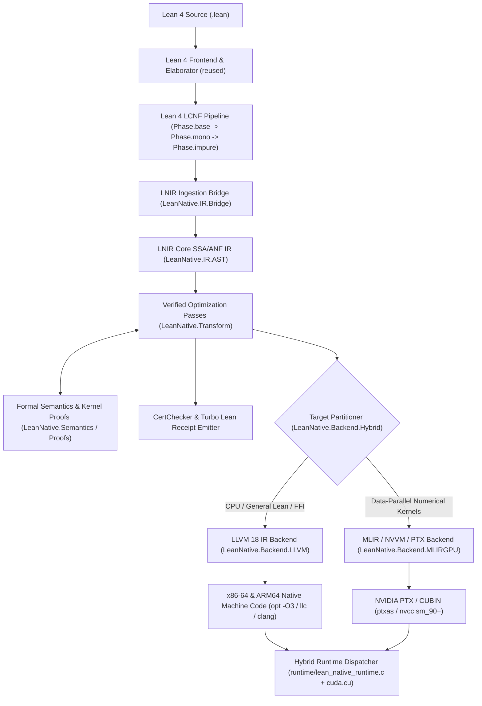

# Lean Native (`lean-native`) Architecture

## 1. System Overview

`lean-native` is a formally validated, self-optimizing native compiler for Lean 4 targeting **x86-64**, **ARM64**, and **NVIDIA CUDA (NVVM/PTX)** with automatic hybrid CPU/GPU execution.

---

## 2. Intermediate Representation (`LNIR`)

`LNIR` (`LeanNative.IR.Types` and `LeanNative.IR.AST`) bridges Lean 4's `LCNF` and low-level target code generation:

- **Types (`LNIRType`)**:
  - Unboxed scalars: `i1`, `i8`, `i16`, `i32`, `i64`, `usize`, `f32`, `f64`
  - Unboxed product/struct types: `tuple (fields : List LNIRType)` (enabling multi-value register return and SROA across join points and worker calls)
  - Contiguous unboxed buffers/slices: `sarray (elem : LNIRType)` (modeling `ByteArray`, `FloatArray`, and monomorphized `UInt64`/`Float` buffers with explicit exclusivity state)
  - Managed heap pointers: `objPtr` (`lean_object*`), `taggedPtr` (`tobject` / tagged scalar)
- **Operations & Structured Control Flow (`LNIRExpr`, `LNIRStmt`, `LNIRCode`)**:
  - Pure scalar & bitvector ALU operations (`add`, `sub`, `mul`, `div`, `mod`, `shl`, `shr`, `bitAnd`, `bitOr`, `bitXor`, `cmp`, `select`, `fma`)
  - Tuple construction & projection (`mkTuple`, `projTuple`)
  - Explicit RC & constructor operations (`allocCtor`, `ctorGetObj`, `ctorGetScalar`, `ctorSetObj`, `ctorSetScalar`, `incRef`, `decRef`, `isExclusive`)
  - Contiguous scalar array operations (`sarrayLen`, `sarrayDataPtr`, `sarrayEnsureExclusive`, `rawLoad`, `rawStore`)
  - Structured loops & data-parallel kernels:
    - `seqFor (lo hi : VarId) (init : VarId) (body : LNIRCode)`: Sequential counted loop with unboxed induction variable and register-resident accumulator.
    - `parFor (n : VarId) (inputs : List VarId) (output : VarId) (kernel : ParallelKernel)`: Data-parallel map/zipWith/stencil/reduction kernel eligible for GPU PTX lowering or CPU SIMD vectorization (`!llvm.loop.vectorize.enable`).

---

## 3. Formally Verified Optimization Passes

Every optimization pass in `LeanNative.Transform` implements the `VerifiedPass` interface:
1. **`AlgebraicOpt`**: Strength reduction (`x * 2^k -> x << k`, `x / 2^k -> x >> k`), additive/multiplicative identities (`x + 0 -> x`, `x * 1 -> x`, `x * 0 -> 0`), idempotent bitwise folding (`x & x -> x`, `x ^ x -> 0`), and constant propagation.
   - **Formal Guarantee**: Kernel-checked proof in `LeanNative.Proofs.PeepholeProofs` (`evalExpr_optimizeExpr_eq`).
2. **`UnboxTupleSROA`**: Eliminates intermediate heap constructor allocations (`allocCtor` / `mkTuple` followed by `projTuple`) across let-bindings and tail-recursive join points.
   - **Formal Guarantee**: Kernel-checked proof in `LeanNative.Proofs.LoopOptProofs` (`eval_unboxTupleSROA_refines`).
3. **`HoistExclusivity`**: Hoists `sarrayEnsureExclusive` (`lean_sarray_ensure_exclusive`) and `sarrayDataPtr` (`m_data`) out of `seqFor` / `parFor` loops when the target scalar array does not escape the loop body, converting per-iteration `uset` calls into direct `noalias` pointer stores.
   - **Formal Guarantee**: Kernel-checked proof in `LeanNative.Proofs.LoopOptProofs` (`eval_hoistExclusivity_refines`).
4. **`LoopVectorizeOpt`**: Recognizes unboxed scalar loops (`seqFor` / `parFor`), hoists small-`Nat` scalar guards to loop preheaders, and attaches LLVM loop vectorization (`!llvm.loop.vectorize.enable`) and noalias metadata.

---

## 4. Target Backends & Hybrid Runtime

### 4.1 LLVM 18 CPU Backend (`LeanNative.Backend.LLVM`)
- Emits modern LLVM 18 opaque-pointer IR (`ptr`) with target triples `x86_64-unknown-linux-gnu` and `aarch64-unknown-linux-gnu`.
- Inlines hot-path RC operations (`m_rc > 0` single-threaded increment/decrement with `@llvm.expect.i1`), scalar tagging (`lean_box` / `lean_unbox`), and contiguous scalar array pointer indexing (`getelementptr inbounds double/i64, ptr %data, i64 %idx`).
- Preserves full compatibility with `libleanshared.so` and C/Rust FFI (`@[extern]`).

### 4.2 MLIR / NVVM / PTX GPU Backend (`LeanNative.Backend.MLIRGPU`)
- Analyzes `parFor` and numerical kernel declarations for GPU eligibility (pure scalar arithmetic over contiguous `sarray` buffers, free of heap allocations or recursive closures).
- Emits both:
  1. **MLIR (`gpu` + `scf` + `arith` + `memref` + `nvvm` dialect module)** for MLIR toolchain pipelines, and
  2. **Direct NVVM / PTX 8.0 assembly (`.ptx`)** with 1D/2D grid-stride thread indexing (`%tid.x`, `%ntid.x`, `%ctaid.x`, `%nctaid.x`), fused multiply-add (`fma.rn.f64` / `mad.lo.u64`), and bounds guards (`setp.ge.u64 %p, %idx, %n; @%p bra DONE;`), compiled and validated by `ptxas` / `nvcc`.

### 4.3 Hybrid CPU/GPU Execution (`LeanNative.Backend.Hybrid` & `runtime/`)
- Automatically partitions programs into GPU kernels (compiled to PTX/CUBIN) and host orchestration + non-GPU functions (compiled by the LLVM CPU backend).
- Uses an adaptive cost model (`N >= LEAN_NATIVE_GPU_MIN_ELEMS`, default `65536`) to dispatch large data-parallel workloads to the NVIDIA GPU via CUDA Driver API (`cuModuleLoadData`, `cuLaunchKernel`) or unified memory (`cudaMallocManaged` on Grace-Blackwell GB10), while seamlessly falling back to the SIMD-vectorized LLVM CPU kernel for small inputs or when no GPU is available.

---

## 5. v0.3 Architecture Additions: `lean-native-core`, 256-Bit EVM & Storage Maps, FastCheck Constraint Propagation, and JSON-RPC Worker

### 5.1 Split Architecture (`lean-native-core` vs `lean-native`)
- **`lean-native-core` (`LeanNative/Core.lean`, `LeanNative/Driver/CoreMain.lean`)**:
  - Zero `import Lean` dependencies; linked strictly against `libleanrt.a` + system C/C++ libraries (`3.7 MB` stripped binary, **`2.454 ms`** cold start on ARM64).
  - Ingests serialized LNIR (`LNIR_WIRE_V1` wire format or JSON via `LeanNative/IR/Codec.lean`), executes the verified optimization passes, runs `verify-certs` and `validate-tv`, and emits LLVM 18 IR, MLIR, PTX 8.0, and FastCheck kernels.
  - Provides a persistent **JSON-RPC `worker` mode** (`lean-native-core worker`) over `stdin`/`stdout` with **`0.0716 ms/req` (`13,973 req/s`)** latency on ARM64 and **`0.2154 ms/req` (`4,643 req/s`)** on x86-64.
- **`lean-native` (`LeanNative.lean`, `LeanNative/Driver/Main.lean`)**:
  - Full frontend driver linking `LeanNative.Core` with `LeanNative.IR.Bridge` and `LeanNative.Proofs.AxiomAudit` for `.lean` source elaboration, LCNF `.impure` extraction (with intra-module helper calls and strict failure when `--input <file.lean>` yields 0 declarations), and `build-exe`.

### 5.2 Native 256-Bit EVM Integers (`u256`/`i256`) & Storage Maps (`storageMap`)
- **Types & Values**: `UInt256` (`EVMWord`), `LNIRType.u256`, `LNIRType.i256`, and `LNIRType.storageMap` with formal `StorageMapState` (`slot -> UInt256` with default `0`) in `HeapState`.
- **Operations & Proofs**: 256-bit wrapping & checked-overflow operations (`addChecked256`, `subChecked256`, `mulChecked256`), full-precision 512-bit intermediate `mulDivDown` / `mulDivUp`, `clz256`, `sar`, and `storageLoad` / `storageStore`, backed by **61 machine-checked kernel theorems** (`0 sorryAx`).
- **LLVM 18 & PTX 8.0 Codegen**:
  - LLVM 18: Native `i256`, `@llvm.uadd/usub/umul.with.overflow.i256`, `@llvm.ctlz.i256`, `zext i256 to i512` for `mulDivDown`/`mulDivUp`, and `@lean_native_evm_sload` / `@lean_native_evm_sstore`.
  - PTX 8.0: 4-limb 64-bit hardware carry-chain arithmetic (`add.cc.u64` / `addc.cc.u64` / `sub.cc.u64` / `subc.u64` / `mad.lo.cc.u64` / `mad.hi.cc.u64`) in `lean_native_kernel_evm_u256_batch`.

### 5.3 Certified FastCheck Fuzzing Kernel Generator (`LeanNative/Backend/FastCheck.lean`)
- **Equality Constraint Propagation (`propagatePreconditionEqualities`)**: Rewrites guard preconditions `x_i == expr` into direct generator assignments `x_i := expr`, eliminating vacuous passes on sparse equality-constrained theorems (`0 -> 4,193` satisfied preconditions on `evm_constrained_buggy_prop`).
- **Certified Counterexample Validator (`certifyCounterexample`)**: Re-evaluates every candidate counterexample through `LeanNative.Semantics.Eval.evalCode`, backed by `certifyCounterexample_no_false_positive` (`0` false positives).
- **Native RFC-Compliant BLAKE3 (`LeanNative/TurboLean/Adapter.lean`)**: Pure-Lean BLAKE3 implementation (`blake3Hex`, `blake3SelfTest = true`) with zero `python3` subprocess calls.
